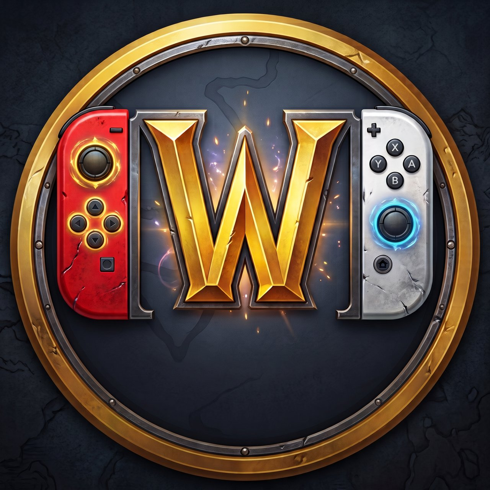
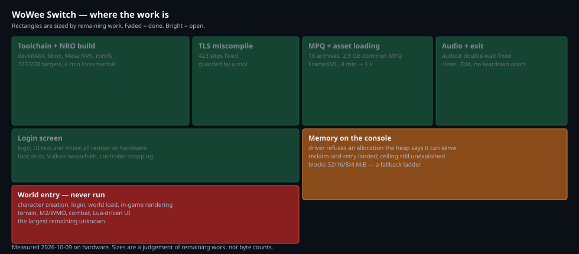

# wowee-switch

<p align="center">
  
</p>

<p align="center">
  <a href="GETTING_STARTED.md"></a>
  
  
  
</p>

<p align="center"><i>The World of Warcraft: Wrath of the Lich King (3.3.5a) client,
running natively on Nintendo Switch hardware — devkitA64 + libnx, Vulkan via
Mesa NVK, with a controller-native UI.</i></p>

## About

WoWee is a source port of the 3.3.5a client to the Switch: the game logic,
interface (stock FrameXML + Lua 5.1), and rendering run on-console against
your own WotLK data, targeting private/local servers and an offline local
realm. There is no streaming, no emulation layer, and no Blizzard code or
game data in this repository — the `.MPQ` archives stay yours, on your SD
card.

- **Players:** this file. Install below, play, report back with logs.
- **Builders:** [GETTING_STARTED.md](docs/GETTING_STARTED.md) — the verified Linux
  path, end to end.
- **Porting approach & licensing:** [PORTING.md](docs/PORTING.md).
- **Live project state:** [AGENTS.md](AGENTS.md) — the hardware loop, the
  console on the LAN, and how a run gets diagnosed.



---

## Status: read this before you try it

**It runs on hardware, in-world.** Boots through the Vulkan renderer and all 18 client
MPQs, renders the login screen with working audio, character creation, and —
as of 2026-10-09, launched via Title Override (hold R on any game, for the full
~3.2 GB RAM) — enters the world: terrain streaming, NPCs, HUD, ground clutter.
The in-world UI is a controller-native action bar with radial menu
(ConsolePort), playable offline in the local realm as well as on servers.
The remaining work is console memory tuning and polish, not boot blockers. See
[AGENTS.md](AGENTS.md) for the live status and the hardware debugging loop.

A static audit of the code found six defects that stopped the first run. They are
listed in full, with file and line references, in
[AUDIT_FIRST_RUN.md](docs/AUDIT_FIRST_RUN.md). **The short version:**

| # | What happens | Status |
|---|--------------|--------|
| 1 | Audio plays about 20 ms of sound, then goes permanently silent. | **fixed** |
| 2 | Any graphics/audio setting you change before your first successful login is silently discarded — no error, no log. | open |
| 3 | Local-realm character saves are written to a PlayStation path that does not exist on a Switch, so saving fails. | open |
| 4 | If startup fails, the on-screen error is a bare code (`Threw fatal error type 2`). The message explaining what went wrong is thrown away. | open |
| 5 | The login connection sets a socket address field the Switch network stack may reject. Unverified — needs a console. | open |
| 6 | The title asks for a 1.5 GB heap, which may not be granted on a 2 GB console. | open |

Two further defects were found on hardware and are also fixed: a `thread_local`
miscompilation that aborted instantly at startup, and an ImGui font-atlas
allocation that handed the driver an out-of-range memory type.

There are also two things that will make the console experience poor even once
the above are fixed:

- **Suspending is not handled.** There is no applet hook, so the Home menu, the
  sleep button and docking/undocking are not responded to. A failed present is
  treated as permanent, so the most likely outcome is a black screen that never
  recovers. Force-close the title from the Home menu if this happens.
- **Closing from the Home menu does nothing.** The exit request is detected and
  then ignored.

So: **installing this today gets you a working login screen, and a support
channel that is actively being used.** The
[audit](docs/AUDIT_FIRST_RUN.md) is the to-do list, in priority order.

### Servers

**You need your own server.** Blizzard's retail realms will not work: Warden
cannot execute its native modules on Horizon (the OS does not provide anonymous
RWX mappings), which rules out any realm that issues a Warden challenge. That
leaves private and local servers as the only realistic target — which is the
configuration this port was aimed at.

---

## What you need

- A hacked Switch (homedbrew-capable, with a recent Atmosphère and sigpatches).
- An SD card.
- **Your own copy** of a WotLK 3.3.5a client `Data` directory. Blizzard's game data
  is not included and cannot be. You need the `.MPQ` archives with their locale
  subdirectories intact.
- A server to connect to. See above.
- A built `wowee.nro` and its `data/` directory — either build it yourself
  ([GETTING_STARTED.md](docs/GETTING_STARTED.md)) or get them from someone who has.

## Installing

Copy these to the SD card, keeping the layout exactly:

```
sdmc:/switch/wowee/wowee.nro      the title
sdmc:/switch/wowee/data/           assets and metadata (must travel with the .nro)
sdmc:/wowps/Data/                 your own WotLK client data
```

`switchpkg` stages the first two for you into `wowee/out/switch/switch/wowee/`;
copy that `wowee` folder to `sdmc:/switch/`.

Then open the homebrew menu and launch **WoWee**.

### If your game data is somewhere else

By default the client looks for `sdmc:/wowps/Data`. To change that, create a text
file at:

```
sdmc:/wowps/wowps/config/paths.cfg
```

containing a single line:

```
data_path=sdmc:/wotlk
```

Point it at either the folder that *contains* your `Data` directory, or the
`Data` directory itself — both are tried. Blank lines and `#` comments are
ignored.

This is the only thing you may need to set up by hand.

### How to find your logs

This is the only diagnostic channel the port has — a homebrew process's console
output is not visible on the Switch — so when something goes wrong, start here:

```
sdmc:/wowps/wowps/logs/boot.log     startup, one line per milestone
sdmc:/wowps/wowps/logs/wowps.log    the running client's log
```

Worth knowing: on a Release build the log level is pinned to `WARNING` and there
is currently no way to change it from the console, so most informational detail
is suppressed — including which asset archives were opened and which expansion
profile was chosen.

## Controls

The in-world UI is a controller-native action bar (ConsolePort) rather than
the PC hotbars: face-button clusters with ZL/ZR modifier tiers, plus a radial
utility ring. Buttons below are named by position — **X top, Y left, A right,
B bottom** — since letter layouts differ between controllers.

**On the pad**

| | |
|---|---|
| Left stick | Walk forward / back, strafe |
| Right stick | Mouse look (or move the cursor off the world screen) |
| X (top) | Jump |
| B (bottom) | Cancel: stops casting and attacking, clears the target; closes open menus while held |
| Y (left) | Auto-attack (toggle — press again to stop) |
| A (right) | Interact / loot / attack (nearest enemy is acquired if you have no target); a mouse click in menus (hold to drag); loots corpses |
| L (left bumper) | Target nearest (friend or foe) and act on it: talk, loot, or attack |
| R (right bumper) | Bags |
| ZL / ZR | Shift / Ctrl tiers: each face button and bumper reaches more action slots; holding both gives a third pane |
| D-pad | Extra action slots |
| L3 | Toggle autorun |
| R3 | Toggle cursor / mouse-look |
| − (minus) | Utility ring (radial menu) |
| + (plus) | System menu |

**Minus and Plus combos** open panels directly: Minus with ZL/ZR held opens
bags, spellbook, or talents; Plus with ZL/ZR held opens the world map,
character sheet, or quest log.

**Held modifiers** — ZL, ZR, or both held together swap every face button and
bumper to another pane of action slots.

**In a text field** (server address, realm name, character name, chat):

| | |
|---|---|
| A (right) | Left click |
| B (bottom) | Right click |
| Y (left) | Open the on-screen keyboard |
| X (top) | Backspace |
| − (minus) | Send |
| + (plus) | Close the box |
| R (right bumper) | Next field |
| D-pad | Move the caret, and walk chat history up / down |

To open chat in the world, hold **both bumpers** (L and R) at the same
time. That gesture is deliberately the only thing that claims it — everything
else is already spoken for. See the comment at
`wowee/include/platform/switch/input_switch.hpp` for the reasoning.

### Known control gaps

- **The Plus (system menu) may open nothing visible.** Known issue, benched —
  the keypress is confirmed to dispatch, but no panel appears. The Minus/Plus
  combos above still open every panel directly.
- **The utility ring opens but has no selection gesture yet,** so its buttons
  can't be activated from the pad. Tracked; the ring already ships with
  Hearthstone plus spellbook/talent/character/map/quest doors for when it lands.
- **The touchscreen cannot click.** It moves the cursor and nothing else. Use the
  right stick and A to press buttons; there is no tap-to-click and no multitouch.
- A **single** Joy-Con is not read. Handheld mode and a docked Pro Controller both
  work.
- If the on-screen keyboard opens and then the game leaves that screen without
  closing it, **all controller input stops** until you restart. If input dies,
  restart the title.

## Troubleshooting

| Symptom | Likely cause |
|---------|--------------|
| Nothing at all, or a brief flash | Check `logs/boot.log` first. A common cause is `data/` missing from beside the `.nro`. |
| `Threw fatal error type 2` | Any startup failure; the real message was discarded (blocker 4). Often the game `Data` directory not being found at `sdmc:/wowps/Data`. |
| Sound cuts out after a moment | Expected. See blocker 1. |
| Settings don't stick | Expected before first login. See blocker 2. |
| Black screen, title still running | A failed present is treated as permanent. Force-close from the Home menu. |
| Pad does nothing | Suspect the on-screen keyboard is stuck open, or that no controller was detected at boot. |
| Plus opens nothing | Known issue (benched). Every panel is still reachable through the Minus/Plus combos listed under Controls. |

## Contributing

The bottleneck is hardware time, not code review. The highest-value
contributions, in order:

1. **Console runs with logs.** Play on hardware, and when something breaks,
   pull `sdmc:/wowps/wowps/logs/boot.log` and `wowps.log` (see above) and
   attach them with what you were doing. `logs/console/` is git-ignored for
   exactly this — run artifacts may contain realmlist addresses and account
   names, so check before posting anywhere public.
2. **Reproductions with teeth.** A report that names the button pressed, the
   target, and the visible result beats a perfect theory. Screenshots of the
   bar help more than descriptions of it.
3. **Code.** Open PRs against `main`; small, one-concern commits with log
   evidence beat large refactors. The Switch toolchain (`devkitA64`) is only
   needed for hardware builds — the Linux host build covers most UI and
   systems work.

## Acknowledgments

This port stands on other projects' work, used with thanks:

- **[WoWee](https://github.com/Kelsidavis/WoWee)** — the 3.3.5a client this
  project derives from.
- **[WoWPS](https://github.com/01cedric/WoWPS)** — the console port (PS4)
  whose platform-layer split made this Switch retarget possible; see
  [PORTING.md](docs/PORTING.md) for what was kept and what was replaced.
- **WoWx** — a WoW Xbox port, now offline, that inspired attempting this at
  all.
- **[ConsolePortLK](https://github.com/leoaviana/ConsolePortLK)** — the
  3.3.5a backport of ConsolePort whose controller UI, assets, and bindings
  ship as this port's native in-game interface (see `wowee/addons/`).

Blizzard's game data and client art are not included anywhere here and this
project is not affiliated with or endorsed by Blizzard Entertainment.

## Legal

Blizzard game data is not included and cannot be — bring your own 3.3.5a
`Data` directory (see Installing). This project is not affiliated with or
endorsed by Blizzard Entertainment.

Distributing a binary requires shipping the corresponding source: the client
statically links the Mesa NVK driver, which makes the result a combined work
under the GPL. See `wowee/switch/third_party/nxvk/NOTICE.md` and
[PORTING.md](docs/PORTING.md#licensing).